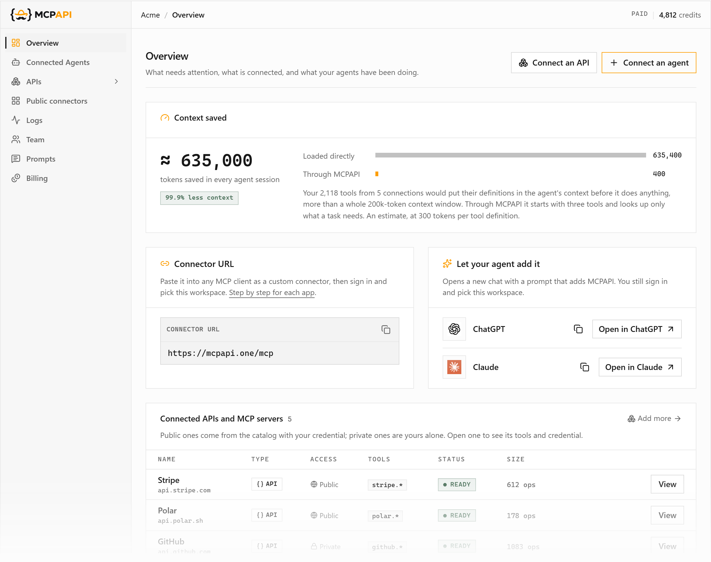

<p align="center"></p>

# MCPAPI

[](https://glama.ai/mcp/connectors/one.mcpapi/mcpapi) [](https://mcptry.com/servers/com.getmcpapi/mcpapi)

**Every API your agent needs, through one MCP server and three tools.**

MCPAPI is a hosted MCP server. Add any OpenAPI or Swagger spec, Postman collection or MCP server to your workspace, or enable a public connector, and your agent reaches all of them through three tools: it searches in plain words, reads only the operation it picked, and runs it.

Connected directly, every tool definition is sent with every request. Stripe's API has 612 operations at roughly 300 tokens each; through MCPAPI the agent carries about 470 tokens of tool definitions, whatever you connect.

[Website](https://getmcpapi.com) · [Documentation](https://docs.mcpapi.one) · Server URL: `https://mcpapi.one/mcp` (streamable HTTP) · Sign-in: OAuth 2.1 or an API key

<picture>
  <source media="(prefers-color-scheme: dark)" srcset="docs/src/assets/screenshots/overview-dark.png">
  
</picture>

> Screenshots show a made-up workspace. Light and dark themes follow your GitHub appearance.

This repository holds MCPAPI's [documentation site](docs/) and its registry metadata (`server.json`). MCPAPI itself is a hosted service; its source is not published here.

## Tools

| Tool | What it does |
| --- | --- |
| `search_tools` | Finds API operations for a task described in plain words. Takes `query`, optionally `source` (one API, e.g. `"stripe"`) and `limit` (1 to 20, default 5). Returns each match's id, source, kind, summary and risk. |
| `get_tool_details` | Returns one operation's description, risk and input schema. Takes `id` from `search_tools`; a nested argument is listed by its fields, and `field` expands one. |
| `execute_tool` | Runs an operation. Takes `id` and `arguments` matching its input schema, optionally `search_id` and `connection` (one of the API's connections that search lists). Returns `completed`, `denied`, `pending_approval` or `error`, with a result or a reason. |

Every call runs as one workspace member, with that member's access, and is logged. Runs can be set to ask a person first.

## Connect

You need an MCPAPI account: sign up at https://getmcpapi.com, add or enable an API, then connect your client. Each client signs in with your MCPAPI email and asks you to pick a workspace. [Steps for every client](https://docs.mcpapi.one/getting-started/connect/) are in the docs.

**Claude** (web, desktop): Customize → Connectors → Add custom connector, paste `https://mcpapi.one/mcp`.

**ChatGPT** (web): Plugins → + → Add custom MCP server, paste the URL and choose OAuth.

**Claude Code**

```sh
claude mcp add --transport http mcpapi https://mcpapi.one/mcp
```

Then type `/mcp`, pick mcpapi and authenticate.

**Codex**

```sh
codex mcp add mcpapi --url https://mcpapi.one/mcp
codex mcp login mcpapi
```

**Cursor** (`~/.cursor/mcp.json`)

```json
{ "mcpServers": { "mcpapi": { "url": "https://mcpapi.one/mcp" } } }
```

**VS Code** (`.vscode/mcp.json`)

```json
{ "servers": { "mcpapi": { "type": "http", "url": "https://mcpapi.one/mcp" } } }
```

**Any other MCP client**: add a remote server (streamable HTTP) with the URL above. A client that can't do OAuth can send `Authorization: Bearer <key>` with a key created on the dashboard's Agents page. Agents can set themselves up from https://mcpapi.one/auth.md.

## Links

- [Pricing](https://getmcpapi.com/pricing)
- [Public connectors](https://getmcpapi.com/connectors)
- [Privacy](https://getmcpapi.com/privacy) and [terms](https://getmcpapi.com/terms)
- Issues and questions: open an issue in this repository.
